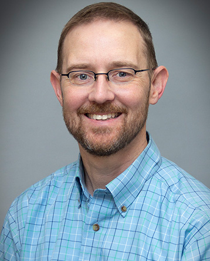

The Kitchin Research Group is in the
[Department of Chemical Engineering](https://www.cmu.edu/cheme/) at
[Carnegie Mellon University](https://www.cmu.edu/). We use data science and
machine learning to solve problems in catalysis and chemical engineering, and we
build open-source software for scientific computing, optimization and
teaching. See [Research](research.qmd), [Publications](publications.qmd) and
[Software](software.qmd) for what we work on.

## John Kitchin {#john-kitchin}

::: {.person}
{.person-photo fig-alt="Portrait of John Kitchin"}

::: {.person-text}
**Professor of Chemical Engineering**, Carnegie Mellon University

::: {.person-links}
[<i class="bi bi-file-earmark-person"></i> CV](https://docs.google.com/document/d/1s6jT5Wb5qyMugkdnEJ-7vv--jIzVlyQ9TgzCnifzMBE/edit?tab=t.0#heading=h.6rphrr2thgpz){.badge-link}
[<i class="bi bi-building"></i> CMU profile](https://www.cmu.edu/cheme/people/faculty/bios/kitchin-john.html){.badge-link}
[<i class="bi bi-mortarboard"></i> Google Scholar](https://scholar.google.com/citations?user=jD_4h7sAAAAJ){.badge-link}
[<i class="bi bi-person-badge"></i> ORCID](https://orcid.org/0000-0003-2625-9232){.badge-link}
[<i class="bi bi-github"></i> GitHub](https://github.com/jkitchin){.badge-link}
[<i class="bi bi-youtube"></i> YouTube](https://www.youtube.com/@JohnKitchin){.badge-link}
[<i class="bi bi-linkedin"></i> LinkedIn](https://www.linkedin.com/in/john-kitchin-6b959038/){.badge-link}
:::
:::
:::

John Kitchin completed his B.S. in Chemistry at North Carolina State University.
He completed an M.S. in Materials Science and a PhD in Chemical Engineering at
the University of Delaware in 2004 under the advisement of Dr. Jingguang Chen
and Dr. Mark Barteau. He received an Alexander von Humboldt postdoctoral
fellowship and lived in Berlin, Germany for a year and a half studying alloy
segregation with Karsten Reuter and Matthias Scheffler in the Theory Department
at the Fritz Haber Institute. He joined the Chemical Engineering Department at
Carnegie Mellon University in January 2006. He was awarded a DOE Early Career
award in 2010 to investigate multifunctional oxide electrocatalysts for the
oxygen evolution reaction in water splitting using experimental and
computational methods, and he received a Presidential Early Career Award for
Scientists and Engineers in 2011. He is a Full Professor.

Professor Kitchin has been investigating how mixtures of metals, also known as
alloys, can be better at catalyzing chemical reactions than pure metals. His
group uses quantum chemical calculations to model alloy surfaces and to relate
their electronic and crystal structures to their reactivity. An outstanding
challenge in the field has been how to model these materials across the entire
composition and structure space. The lattice constants, crystal structures and
reactivities of alloys depend on their composition. Prof. Kitchin's group has
developed new approaches to approximate these dependencies, enabling the
simulation of alloy catalyst surfaces across composition space under reaction
conditions. This approach enables one to design and optimize alloy catalysts for
specific reaction conditions.

Many catalyst properties that we are interested in require tens of thousands of
calculations to be performed. Typical molecular force fields are not
sufficiently accurate to use for simulating chemical reactions on surfaces, but
quantum chemical calculations are too expensive to use directly for these kinds
of simulations. Prof. Kitchin's group is using quantum chemical calculations to
train neural networks for these simulations. His group then uses the trained
networks to efficiently perform molecular dynamics and Monte Carlo simulations
with the underlying accuracy of the quantum chemical calculations. This allows
us to simulate dynamic properties such as diffusion and reactions, as well as
properties like alloy segregation. This work is an essential step to expanding
the utility of quantum chemical calculations to larger systems and longer time
scales in a broad range of applications.
