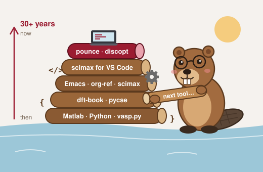
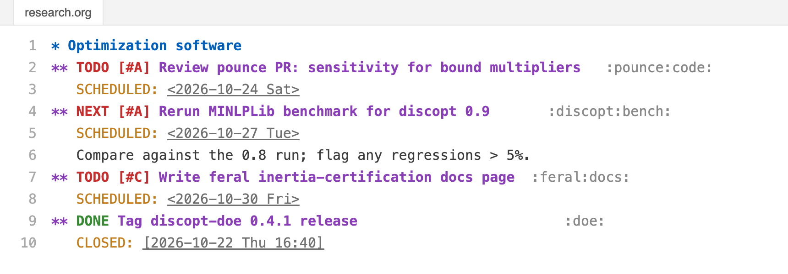
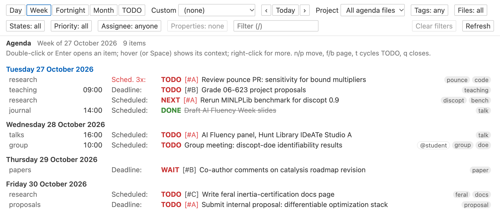
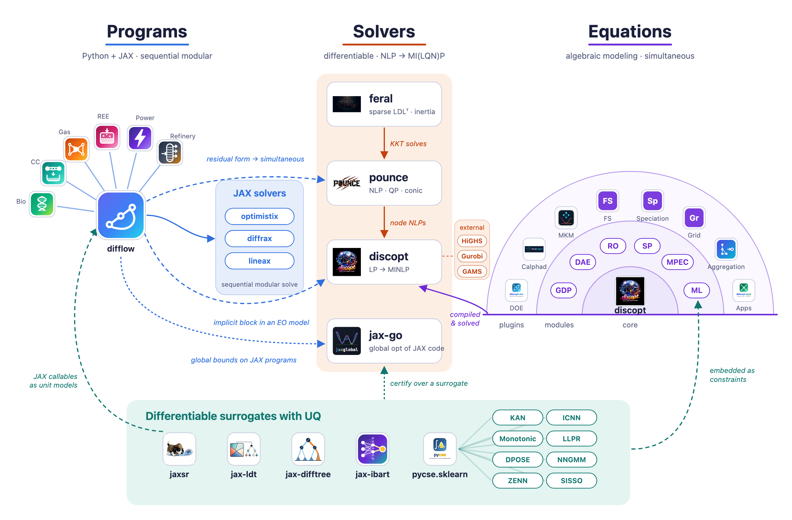

For more than 25 years I have built the tools that make the environment I want
to work in: Python packages for molecular simulation, Emacs and org-mode,
org-ref, scimax, pycse, and most recently scimax for VS Code and a stack of
optimization software. AI has not changed that for me. You might think of me as
a software beaver, and it changed how big a dam one person can build. In the
past year there were about 10,400 commits across scimax, discopt, pounce, feral
and difflow, and about 76% of them were co-authored with an AI coding agent. I
wrote far fewer of the lines than I used to. I wrote the specifications, I
reviewed the changes, and I wrote or approved the tests that decide whether a
change is accepted.

{fig-align="center" width="55%"}

That shift is the subject of this post. When an agent can write code, read papers and run calculations, the bottleneck moves. It used to be typing code; now it is deciding what to build and verifying that it is right. I have written about this before in the context of self-driving laboratories [(Kitchin, 2025)](/papers/kitchin2025b/index.qmd), and with Hongliang Xin and Heather Kulik about what agentic science could look like more broadly [(Xin, Kitchin and Kulik, 2025)](/papers/xin2025/index.qmd). Here I want to be concrete in how we are implementing these ideas. Our approach is mostly embodied in software, so this is a tour of that software and of the ideas that hold it together.

## An agent is only as good as its environment

The simplest way to describe our approach is that we spend our effort on the
environments that we work in and that the agent works in, rather than on the agent itself. Three ideas run
through everything below.

The first is that plain text is ready for agents. Our notes, code, data and
manuscripts live in org-mode and Markdown files that an agent can read, search and
edit with the same tools it uses on source code. Nothing has to be exported or
scraped first.

The second is that abilities should be installable. When an agent needs to know how
to set up a VASP calculation or diagnose a stalled interior point solve, that
knowledge should not live in a prompt someone pasted once. It should ship as a skill
or an MCP server, versioned alongside the code it describes, and be installable with
one command.

The third, and the most important, is that software should report its work. Agents
are fluent, but fluency is not correctness. The tools we build for agents return
structured results, validate their input, raise typed errors instead of returning a
plausible wrong answer, and are tested against references we trust. That gives us
something to check the agent's claims against.

The diagram shows how the pieces fit together. You set the goals and check the
results. The agent does the work through abilities that knowhow installs, using four
groups of tools. Underneath is plain text, and around all of it are checks the agent
cannot talk its way past. The rest of the post follows the diagram from top to
bottom.

```{=html}

```

## The workbench: scimax for VS Code

[scimax for VS Code](https://github.com/jkitchin/scimax_vscode) is where the work
happens. It brings the scimax environment I built in Emacs to VS Code, and it is one
plain-text environment for the whole research cycle. I think in it, with a journal,
notes, an agenda, and a searchable database of every org file I have. I compute in
it, with runnable Python and Jupyter code blocks inside the document. I write in it,
with org-ref citations, BibTeX tools and manuscript publishing for journal
submission. I publish from it, and I present from it, using Marp decks with a pen,
a laser pointer, a timer and live Python. 

Because all of this is plain text, an agent can work with it as easily as I can. A
TODO is just a headline in an org file, and scimax gathers those headlines into an
agenda. Claude can read that agenda and update it too.

::: {layout-ncol=2}



:::

The agent-facing part of scimax is a command-line tool and four skills. The `scimax`
CLI covers the agenda, search, the org database, the journal, tasks and projects,
citation checking, export, tangling, publishing and slide builds.
`scimax skill install` adds skills that teach an agent how to use it, so it can act
as an executive assistant over my notes: a morning briefing, triaging tasks, finding
what is blocked, or working out the critical path through a project. Sites built
with `scimax publish` can include an "Ask" chat that finds the relevant sections and
writes an answer with citations, using a language model that runs in the reader's
browser, so there is no server to maintain. This site has one. scimax for VS Code
has had 838 commits since January 2026, about 72% of them co-authored with AI.

## Giving agents abilities: knowhow

The skills that come with scimax are one example of a broader pattern, and
[knowhow](https://github.com/jkitchin/knowhow) is how we manage it. knowhow is a
package manager for agent capabilities. `uvx knowhow add owner/repo --skill name`
installs skills, slash commands, subagents, hooks and MCP servers from any git
repository. It works with Claude Code, Codex, OpenCode, Gemini, Cursor and Copilot,
and it records what it installed in a lock file so a project's agent setup can be
reproduced. knowhow replaces an earlier tool of ours called skillz.

knowhow also carries a library of our own: 44 skills for scientific, laboratory and
programming work (ASE, VASP, pymatgen, Opentrons robots, design of experiments,
electronic lab notebooks and scientific review, among others), along with
subagents, commands and hooks. Some of the hooks are guardrails rather than
abilities. One keeps an automatic lab-notebook record of what the agent did, and
another keeps it from writing secrets into files.

The most useful thing about knowhow may be the convention it set. Every package in
the rest of this post ships its own skill in `skills/<name>/SKILL.md`, next to the
code it describes. The instructions change when the code changes, and `knowhow add`
can install any of them.

## Knowing what we know: litdb and crucible

Research starts with the literature, and agents are notorious for inventing it. Our
answer is to give the agent a library that we curate, so it searches real papers
instead of what it half-remembers.

[litdb](https://github.com/jkitchin/litdb) is a local database of the papers I care
about, with natural-language search. Its MCP server is read-only by design. An agent
can run semantic and full-text searches, find papers similar to one it already has,
pull new work from OpenAlex, and return citations and BibTeX entries that point to
real records. It can even generate the collaborator list an NSF proposal requires,
which is the kind of tedious, checkable task that suits an agent well.

[crucible](https://github.com/jkitchin/crucible) works one level up. An LLM distills
papers, notebooks and data into an interlinked org-mode wiki, one article per
concept, with an SQLite graph of the links behind it. Ingesting happens in two
steps: the agent first proposes which articles to write or update, then writes them.
Once the wiki exists, an agent can use the crucible CLI to search it, follow
backlinks, find related articles, and look for gaps such as orphan articles and
sources that have not been distilled yet. `crucible publish` turns the wiki into a
website using scimax.

These tools are not wired together in code, but they make one workflow. litdb finds
the papers, crucible distills them into concepts, and scimax is where I write with
them and publish the result. org-ref citation keys run through all three, so a claim
in a draft can be traced back to a paper in the database.

## Computing with agents: fairchem-mcp and discopt-calphad

Most atomistic simulation workflows were designed for people. You write a script,
submit it, wait, and read the output. When an agent drives that workflow, it does
the same thing in a loop: write a script, run it, wait, read a log file, and guess
what went wrong. Every step reloads the model, and the agent finds out that a
calculation went badly only after it is over. We wanted computation that an agent
could work with interactively, and results that carry their own evidence of
correctness.

### Watching and steering simulations

[fairchem-mcp](https://github.com/jkitchin/fairchem-mcp) is an MCP server for the
FAIRChem UMA and eSEN
[machine-learned potentials](/papers/topics/neural-network-potentials/index.qmd), built on ASE. It loads a model
once and keeps it in memory, so every later call reuses it instead of spending
seconds to minutes loading it again. The agent builds or loads a structure and
starts a job: a relaxation, a molecular dynamics run, an NEB calculation, an
equation-of-state or elastic scan, phonons, a formation-energy convex hull, or a
saddle-point or minima search. Each job runs in the background.

The interesting part is what happens while a job runs. `get_status` reports the
step, the energy and the maximum force, along with a trend label: decreasing,
plateaued, stuck or diverging. That label is written for an agent. It turns a
column of numbers into a decision about whether to intervene. If a relaxation is
stuck, the agent can switch the optimizer partway through, and the atoms keep their
positions; only the driver is rebuilt. It can also tighten the force criterion,
change the temperature of an MD run, turn on climbing in an NEB, or pause or abort
the job. The skill that comes with the server teaches this
start, watch and steer loop, including how to respond to each trend label and
which job answers which question.

Two other design choices matter. The high-level tools and an `execute` escape hatch
share one Python namespace, so when no tool fits, the agent can drop into Python on
the same live `Atoms` object the job is using. And `introspect` reads the
signatures and docstrings of the code that is actually installed, rather than
documentation the model may remember from an older version. That removes a common
source of agent errors: calling functions with arguments they no longer take.
Because `execute` runs arbitrary code, this is a tool for a trusted local machine.

The examples in the repository are end-to-end workflows, each written both as a
runnable script and as a sequence of MCP tool calls: adsorption energies,
adsorption-site searches, diffusion barriers, surface phonons, and an alloy design
loop that screens candidates for stability on the convex hull and then ranks the
survivors by stiffness. Three routes to transition states, the dimer method, Sella,
and eigenvector following in pounce, run on the same system so they can be
compared. Installing all of it is one command:

```bash
uvx knowhow add jkitchin/fairchem-mcp --skill fairchem-mcp --mcp fairchem
```

### From energies to certified phase diagrams

A machine-learned potential gives energies of atomic configurations at 0 K.
Materials questions are often about
[phase diagrams](/papers/topics/alloy-phase-diagrams/index.qmd), which need much more: the Gibbs
energy of every competing phase as a function of composition and temperature,
including the liquid. [discopt-calphad](https://github.com/jkitchin/discopt-calphad)
connects the two. It is a discopt plugin that computes CALPHAD phase equilibria, and
it can compute formation and mixing enthalpies from any ASE calculator, UMA
included, and refit the enthalpy terms of an existing thermodynamic database to
them. It does not replace the database's entropy and heat-capacity terms, which a
0 K calculation cannot supply. The agent can then map the phase diagram from the
refitted database, compare it with the original, and see what the potential
changed.

What makes discopt-calphad suitable for agents is that its answers are certified.
A conventional equilibrium calculation finds a local minimum of the Gibbs energy
and cannot tell you whether a more stable phase or a miscibility gap was missed.
discopt-calphad solves the equilibrium locally, then uses discopt's global solver
to check every phase against the result. If any phase could lower the energy, it is
added and the equilibrium is solved again. If none can, the result is certified to
within a stated tolerance. Each result carries a certificate level, and when the
search cannot finish, the result says so instead of reporting an uncertified
answer as if it were certified. In Cu–O, it finds a liquid miscibility gap that a
grid-based calculation misses. An agent does not have to judge whether a phase
diagram looks plausible. It can read the certificate.

Both of these tools use the optimization software described next: pounce for one of
the transition-state searches, and discopt for the certification.

## Solvers that explain themselves



Since December 2025 we have started 15 public repositories in
[differentiable programming](/papers/kitchin2025/index.qmd) and optimization. Together they hold about 1.8 million lines of source
and tests, roughly 1.1 million in Python and 0.66 million in Rust, and they have had
about 63,000 downloads from PyPI in the last 180 days. Projects like these usually
take a team years. The map above, from an
[earlier post](../differentiable-optimization-landscape/), shows how they relate.

Optimization turns out to be a good domain for AI-assisted development because the
answers can be checked. A reported optimum either satisfies the optimality
conditions and matches the reference solution, or it does not, and there are large
public benchmark sets that say what the right answer is. The same property makes
these solvers good tools for agents to use, as long as the solvers explain what they
did. That was a design goal from the start.

[difflow](https://github.com/jkitchin/differentiable-flowsheets) is a JAX framework
for differentiable chemical process flowsheets, for simulation, optimization and
technoeconomic analysis. Its MCP server lets an agent build a flowsheet one step at
a time: choose the species, add units, connect streams and set feeds, with undo and
redo when it makes a mistake. Then it can solve the flowsheet, run sensitivity
analyses and sweeps, optimize it, propagate uncertainty, and estimate costs. When a
flowsheet does not converge, which is the normal state of a new flowsheet, the
diagnosis tools return structured findings and suggested remedies rather than a
stack trace, and `converge` tries the remedies in turn. Each tool is labeled as
reading, editing or executing code, and one server configuration removes arbitrary
Python execution entirely, for when you want the agent to stay inside the modeling
tools. difflow can use pounce and discopt as its solvers.

[pounce](https://github.com/jkitchin/pounce) is a family of interior point solvers
written in Rust. It began as a port of Ipopt and now covers nonlinear, conic and
quadratic programs. Every solve writes a JSON solve report, so an agent reads
structured data instead of parsing an iteration log. The pounce-studio MCP server
has about 30 tools built on those reports. Before a solve, an agent can analyze the
problem and check the starting point. After a solve, it can diagnose the result,
find where progress stalled, look at the convergence trace and the restoration
phases, compare two runs, and verify the solution independently. If that is not
enough, it can step through a solve in a live debugger. pounce also includes
commands for adversarial testing and for reviewing sensitivity results.

[discopt](https://github.com/jkitchin/discopt) is a modeling language and solver for
mixed-integer nonlinear programs, and it has more agent-facing features than
anything else we have built. It ships 17 expert subagents (for MINLP solving,
convexity detection, Ipopt, benchmarking and more) and commands for each stage of
modeling: formulating, diagnosing, debugging, reformulating, explaining a model,
converting it between formats, and reporting on benchmarks. It also has a tool-call
interface for building models from a natural-language description. The agent
creates variables and adds constraints and logical conditions through tool calls,
and the expressions it writes go through a safe parser instead of being executed as
code. When a model is infeasible or a solve goes wrong, discopt produces reports on
infeasibility, convexity and provenance that an agent can act on.

Around discopt is a growing set of [plugins](/software.qmd#discopt-plugins) that
bring the same approach to particular domains. Each one checks its input against a
schema, solves the problem, and reports the result, through a skill or an MCP
server. discopt-mkm does microkinetic modeling for catalysis, including
[degree of rate control](/papers/yang2022b/index.qmd) and limiting potentials. discopt-grid does power systems optimization,
and it was built largely by an autonomous agent loop working from a written
specification and implementation plan. discopt-doe adds design of experiments, with
agents for estimability and identifiability analysis. discopt-flowsheet raises
typed errors instead of returning silently wrong answers. discopt-course is an
optimization course in which Claude Code is the teaching assistant, grading against
rubrics. discopt-calphad, covered in the computing section, is one more plugin.


## Where this is going

The direction is agents that run the whole loop, from literature to computation to
experiment to paper, with people setting the goals and checking the results. The
recent roadmap for AI in heterogeneous catalysis describes that future for one field
[(Xin et al., 2026)](/papers/xin2026/index.qmd). The software here
is our attempt to build the environment it needs.

If I had to compress the approach into advice for students, it would be four things.
Own the verification: you are responsible for every number, line of code and
citation, so learn enough of the fundamentals to know when an answer is wrong. Write
things down in plain text, where an agent can read them. Specify, then delegate: the
skill that matters now is stating a problem precisely, with tests or checks that
define when it is done. And be ambitious, and disclose. Attempt projects that were
out of reach, and take responsibility for what you generate. 

AI does not reduce the need for expertise. It makes judgment more valuable.

All of the software is on our [software page](/software.qmd) and at
[github.com/jkitchin](https://github.com/jkitchin).


