<!-- _class: lead -->
<!-- _paginate: false -->
<!-- _footer: '' -->

# Building a differentiable optimization stack with AI agents

### Programs, solvers, surrogates, and what I learned working with Claude

**John Kitchin** · Department of Chemical Engineering · Carnegie Mellon University

Argonne LANS Seminar · October 29, 2026

<!--
Thank the host. The invitation asked for three things: crucible, pounce and discopt, and my
experience working with Claude. This talk is all three, organized around the
differentiable optimization landscape we have been building this year.
Caveat up front: I am a chemical engineer who learned optimization by building it. Many of
you know these algorithms far better than I do; I am here to show what is now possible
for someone like me, and to hear where I got it wrong.
-->

---

## Where I come from: surfaces to self-driving labs

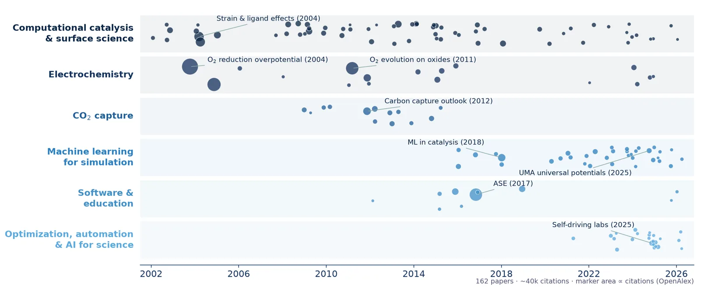

<div class="cols" style="grid-template-columns: repeat(4, 1fr); margin-top: -6px;">
<div class="stat"><b>140+</b><span>papers</span></div>
<div class="stat"><b>~40k</b><span>citations</span></div>
<div class="stat"><b>DFT → ML</b><span>→ optimization</span></div>
<div class="stat"><b>10+</b><span>open-source packages</span></div>
</div>

<!--
~1 min. Each dot is a paper; size ~ citations.
2002-08 DFT surface science; 2009-15 CO2 capture, oxides; 2016- ML for simulation;
2021- optimization, automation, AI for science. The constant thread is software that
makes the science faster. The new part this year: solvers.
-->

---

## The plan

<div class="flow" style="margin: 30px 0 34px 0; height: 150px;">
<div style="background:var(--k-navy)">1. Working with agents<small>knowledge, memory, interface</small></div><div class="arrow">→</div>
<div style="background:var(--k-deep)">2. The landscape<small>programs, solvers, equations</small></div><div class="arrow">→</div>
<div style="background:var(--k-blue)">3. Surrogates<small>that know their uncertainty</small></div><div class="arrow">→</div>
<div style="background:var(--k-mid)">4. Closing the loop<small>agents in the lab</small></div><div class="arrow">→</div>
<div style="background:var(--k-sky)">5. Lessons<small>what worked, what did not</small></div>
</div>

<div class="cols">
<div class="callout"><b>crucible</b>, <b>pounce</b> and <b>discopt</b>, and about working with <b>Claude</b>.</div>
<div class="callout">The common thread: <b>one differentiable model, reused</b> for simulation, estimation, design and control.</div>
</div>

---

## LLMs and research: the field moves in months

<div class="cols">
<div class="side">

Possibly the biggest change in how we do research in my career

- LLMs now write code, use tools, and **work in a loop**
- They still make mistakes, faster and better looking than ever
- They predict likely text: **fluency is what they optimize, not correctness**
- No memory between sessions; everything is in the **context window**

</div>
<div class="side">

**Four levels of tools**

1. Web / desktop chat: short conversations, scripts
2. Editor helpers (Copilot, Cursor): line and function level
3. **Coding agents** (Claude Code, Codex): project level, multi-file, persistent
4. API: LLMs inside your own code

<div class="callout"><b>November 2025</b> was the tipping point for agentic coding for me (Opus 4.5)</div>

</div>
</div>

---

## The agent loop

<div class="cols">
<div class="side">

- An **agent** is an LLM running in a loop with tools
- Tools: edit files, run code, run tests and benchmarks, read papers
- Results go back into the context, so the next step is **grounded in real output**
- The **harness** (Claude Code) runs the loop and manages permissions
- **You** set the goal, steer, and judge the result

<div class="callout">Correctness has to come from outside the model: tests, benchmarks, solvers, experiments</div>

</div>
<div class="center">

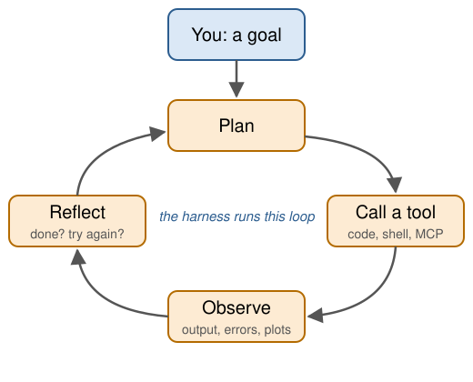

</div>
</div>

---

## Our approach to agentic science

<style scoped>
.ax-link { cursor: pointer; }
.ax-link:hover > rect:first-child { stroke: #0b2545; stroke-width: 3.5; }
.ax-link:hover text { text-decoration: underline; }
</style>

<svg viewBox="0 0 1160 500" width="1160" height="500" style="display:block; margin-top:4px; font-family: Inter, sans-serif;">
  <defs>
    <marker id="ax-arrow" viewBox="0 0 10 10" refX="9" refY="5" markerWidth="6" markerHeight="6" orient="auto-start-reverse">
      <path d="M0,0 L10,5 L0,10 z" fill="#2a7fc1"/>
    </marker>
    <clipPath id="ax-card"><rect width="96" height="96" rx="14"/></clipPath>
  </defs>
  <!-- connectors -->
  <g stroke="#2a7fc1" stroke-width="3.5" fill="none">
    <line x1="174" y1="250" x2="236" y2="250" marker-start="url(#ax-arrow)" marker-end="url(#ax-arrow)"/>
    <line x1="414" y1="250" x2="476" y2="250" marker-start="url(#ax-arrow)" marker-end="url(#ax-arrow)"/>
    <line x1="664" y1="250" x2="726" y2="250" marker-start="url(#ax-arrow)" marker-end="url(#ax-arrow)"/>
    <line x1="570" y1="122" x2="570" y2="176" marker-end="url(#ax-arrow)"/>
    <line x1="570" y1="324" x2="570" y2="378" marker-start="url(#ax-arrow)" marker-end="url(#ax-arrow)"/>
  </g>
  <g font-size="14" fill="#1f5f99" font-style="italic" text-anchor="middle">
    <text x="205" y="222">ask</text><text x="205" y="238">review</text>
    <text x="445" y="238">chat</text>
    <text x="695" y="222">run</text><text x="695" y="238">measure</text>
  </g>
  <g font-size="14" fill="#1f5f99" font-style="italic">
    <text x="582" y="155">skills</text>
    <text x="582" y="356">read · write</text>
  </g>

  <!-- people -->
  <rect x="0" y="170" width="174" height="160" rx="16" fill="#f3f8fc" stroke="#5aa9dd" stroke-width="2"/>
  <g fill="#13315c">
    <circle cx="70" cy="212" r="13"/><path d="M48,258 q22,-34 44,0 z"/>
    <circle cx="118" cy="216" r="11" opacity="0.6"/><path d="M100,256 q18,-28 36,0 z" opacity="0.6"/>
  </g>
  <text x="87" y="290" text-anchor="middle" font-size="21" font-weight="800" fill="#0b2545">People</text>
  <text x="87" y="311" text-anchor="middle" font-size="13" fill="#5a6b7d">set goals, approve,</text>
  <text x="87" y="327" text-anchor="middle" font-size="13" fill="#5a6b7d">judge results</text>

  <!-- scimax: interface -->
  <a href="https://github.com/jkitchin/scimax_vscode" target="_blank" class="ax-link">
  <rect x="236" y="150" width="178" height="200" rx="16" fill="#f3f8fc" stroke="#5aa9dd" stroke-width="2"/>
  <g transform="translate(277,162)"><rect width="96" height="96" rx="14" fill="#fff"/><image href="figures/scimax-logo.webp" x="16" y="0" width="64" height="96"/></g>
  <text x="325" y="288" text-anchor="middle" font-size="21" font-weight="800" fill="#0b2545">scimax</text>
  <text x="325" y="309" text-anchor="middle" font-size="15" font-weight="700" fill="#1f5f99">INTERFACE</text>
  <text x="325" y="329" text-anchor="middle" font-size="13" fill="#5a6b7d">notes · code · slides</text>
  </a>

  <!-- agent -->
  <rect x="476" y="176" width="188" height="148" rx="18" fill="#0b2545"/>
  <text x="570" y="228" text-anchor="middle" font-size="24" font-weight="800" fill="#fff">AI agent</text>
  <text x="570" y="256" text-anchor="middle" font-size="13" fill="#dbeaf7">Claude Code, Codex,</text>
  <text x="570" y="273" text-anchor="middle" font-size="13" fill="#dbeaf7">Copilot, Gemini</text>
  <text x="570" y="302" text-anchor="middle" font-size="14" font-weight="600" fill="#5aa9dd">plans · codes · analyzes</text>

  <!-- knowhow: knowledge -->
  <a href="https://github.com/jkitchin/knowhow" target="_blank" class="ax-link">
  <rect x="430" y="0" width="280" height="122" rx="16" fill="#f3f8fc" stroke="#5aa9dd" stroke-width="2"/>
  <g transform="translate(444,13)" clip-path="url(#ax-card)"><image href="figures/knowhow.png" width="96" height="96"/></g>
  <text x="556" y="44" font-size="21" font-weight="800" fill="#0b2545">knowhow</text>
  <text x="556" y="67" font-size="15" font-weight="700" fill="#1f5f99">KNOWLEDGE</text>
  <text x="556" y="89" font-size="13" fill="#5a6b7d">skills: how we</text>
  <text x="556" y="106" font-size="13" fill="#5a6b7d">do things</text>
  </a>

  <!-- crucible: memory -->
  <a href="https://github.com/jkitchin/crucible" target="_blank" class="ax-link">
  <rect x="430" y="378" width="280" height="122" rx="16" fill="#f3f8fc" stroke="#5aa9dd" stroke-width="2"/>
  <g transform="translate(444,391)" clip-path="url(#ax-card)"><rect width="96" height="96" fill="#fdfcfa"/><image href="figures/crucible-logo-sourcerer.webp" x="-8" y="-6" width="112" height="112"/></g>
  <text x="556" y="422" font-size="21" font-weight="800" fill="#0b2545">crucible</text>
  <text x="556" y="445" font-size="15" font-weight="700" fill="#1f5f99">MEMORY</text>
  <text x="556" y="467" font-size="13" fill="#5a6b7d">what we have</text>
  <text x="556" y="484" font-size="13" fill="#5a6b7d">learned, linked</text>
  </a>

  <!-- lab and compute -->
  <rect x="726" y="150" width="434" height="200" rx="16" fill="#f3f8fc" stroke="#5aa9dd" stroke-width="2"/>
  <text x="748" y="186" font-size="21" font-weight="800" fill="#0b2545">Lab &amp; compute</text>
  <g font-size="15" fill="#1b2a3a">
    <text x="748" y="218"><tspan font-weight="700" fill="#1f5f99">Robots:</tspan> Opentrons, BioLector, Cloud Lab</text>
    <a href="https://github.com/jkitchin/discopt-doe" target="_blank" class="ax-link"><text x="748" y="246"><tspan font-weight="700" fill="#1f5f99">Design:</tspan> <tspan text-decoration="underline">discopt-doe</tspan></text></a>
    <text x="748" y="274"><tspan font-weight="700" fill="#1f5f99">Models:</tspan> <a href="https://github.com/jkitchin/jaxsr" target="_blank" class="ax-link"><tspan text-decoration="underline">jaxsr</tspan></a>, <a href="https://github.com/jkitchin/differentiable-flowsheets" target="_blank" class="ax-link"><tspan text-decoration="underline">difflow</tspan></a></text>
    <text x="748" y="302"><tspan font-weight="700" fill="#1f5f99">Data:</tspan> MFI data backbone</text>
  </g>
  <text x="748" y="332" font-size="13" fill="#5a6b7d">the agent drives these through skills</text>
</svg>

<div class="small center muted" style="margin-top:2px">Click a box to open its GitHub repo · all open source · plain text you can read and version · works with any agent</div>

<!--
The picture: people stay in charge and talk to the agent through scimax, where we
already write notes, code and papers. The agent gets our know-how from skills
(knowhow), remembers across sessions through crucible, and acts on the lab and
compute through tools like discopt-doe and the Opentrons skill. The next slides
take each piece in turn.
-->

---

## crucible: a persistent knowledge base the agent maintains

<div class="cols-2-3">
<div class="center">


<div class="tiny">github.com/jkitchin/crucible · pip install crucible-llm</div>

</div>
<div class="side">

Agents forget between sessions. **crucible** gives them a memory you can read:

<div class="flow small" style="margin:10px 0">
<div style="background:var(--k-navy)">Ingest<small>papers, notebooks, data</small></div><div class="arrow">→</div>
<div style="background:var(--k-deep)">Distill<small>LLM writes org wiki</small></div><div class="arrow">→</div>
<div style="background:var(--k-blue)">Query<small>keyword + semantic</small></div><div class="arrow">→</div>
<div style="background:var(--k-mid)">Capture<small>answers become articles</small></div>
</div>

- Interlinked **org-mode wiki** with citations, backed by a **graph database**
- Copyrighted sources stay local; distilled wiki is shareable
- **Peer crucibles**: search across all your knowledge bases


</div>
</div>

<!--
Inspired by Karpathy's LLM knowledge-base pattern. The wiki is the agent's domain;
I rarely edit it. Each conversation adds up instead of evaporating. Every project
(including MFI) has its own crucible; a CLAUDE.md directive tells the agent to check
it before answering domain questions. Useful for proposals, student meetings, lab notebooks.
-->

---

## knowhow: install skills from any repo, one command

<div class="cols-2-3">
<div class="center">

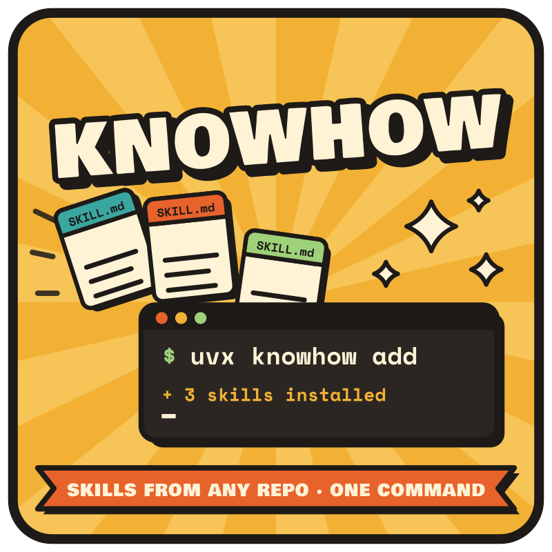

<div class="tiny">github.com/jkitchin/knowhow</div>

</div>
<div class="side">

```bash
uvx knowhow add jkitchin/knowhow --list
uvx knowhow add jkitchin/knowhow -s opentrons -s design-of-experiments
uvx knowhow add jkitchin/knowhow --subagent literature-searcher
uvx knowhow check && uvx knowhow upgrade
```

**44 skills** in the repo, including:

- **Lab automation:** 7 Opentrons skills (Flex, thermocycler, plate reader, ...)
- **Simulation:** ASE, VASP, pymatgen, fairchem, IDAES, pycalphad
- **Research:** DoE, literature review, citation verification, ELN

<div class="small muted">Nothing to install first · tracked lock files · never overwrites your files · hooks/MCP code shown for review</div>

</div>
</div>

<!--
knowhow is the tool and a collection. Any git repo with SKILL.md files works,
so a group can publish its own lab's skills and students install them in one line.
Compatible with npx skills. Safety: shows hook and MCP scripts before installing.
Offer: happy to help anyone write skills for their own instruments or courses.
-->

---

## scimax for VS Code: where we write, compute and talk to agents

<div class="cols-2-3">
<div class="center">


<div class="tiny">github.com/jkitchin/scimax_vscode</div>

</div>
<div class="side">

A decade of Emacs **scimax** (org-mode, org-ref, journals), now in **VS Code**

- Literate programming: run Python, R, Julia, any **Jupyter** kernel in org/Markdown
- Citations, journal, projects, full-text + semantic search of all your notes
- **Marp decks** (this one): sorter, presenter tools, edit slides with Claude Code
- `scimax` CLI + **4 agent skills** so agents search notes, agendas, export

<div class="cols" style="grid-template-columns: repeat(3, 1fr); margin-top: 8px;">
<div class="stat"><b>~222k</b><span>lines of TypeScript</span></div>
<div class="stat"><b>3,802</b><span>unit tests</span></div>
<div class="stat"><b>weeks</b><span>built with Claude Code</span></div>
</div>

</div>
</div>

<!--
I never knew TypeScript or VS Code internals; Claude Code made it possible to port
scimax in a few weeks, extended to Markdown and LaTeX. I use it nearly daily.
The broader point: agents let domain experts build real software tools.
Install from the VSIX on GitHub releases.
-->

---

<!-- _class: lead -->
<!-- _paginate: false -->

# 2. The differentiable optimization landscape

### Programs, solvers and equations

---

## The pivot: from ML potentials to differentiable optimization

<div class="cols-3-2">
<div class="side">

- A decade of **ML surrogates for DFT** taught me differentiable programming (JAX, PyTorch)
- Argued in a perspective that AD is the next modeling paradigm in ChemE
- This year's goal: an **end-to-end differentiable optimization stack**
  - differentiable **programs**
  - differentiable **solvers**
  - differentiable **surrogates** with uncertainty
- I learn by doing, and agents made it possible to do this in a year

</div>
<div class="side">

**Some of what I have built in 2025-26 (repo created)**

| | |
|---|---|
| Dec 2025 | **difflow**: flowsheets in JAX |
| Feb 2026 | ripopt (abandoned), **discopt**, **jaxsr** |
| Apr 2026 | **feral**: sparse LDLᵀ |
| May 2026 | **pounce**: interior point |
| Oct 2026 | **jax-go**: global opt of JAX code |

</div>
</div>

<div class="ref">J. R. Kitchin, V. Alves, C. D. Laird, Nat. Chem. Eng. 2, 11 (2025), doi:10.1038/s44286-024-00170-x</div>

<!--
The landscape post (kitchingroup.cheme.cmu.edu/posts/differentiable-optimization-landscape)
is the written version of this section.
-->

---

<!-- _paginate: false -->
<!-- _footer: '' -->

<style scoped>
section { padding: 6px 20px; }
.ifr { width: 977px; height: 688px; margin: 0 auto; overflow: hidden; position: relative; background: url(figures/landscape-static.png) 0 0 / 977px auto no-repeat; }
.ifr iframe { width: 1320px; height: 930px; border: 0; transform: scale(0.74); transform-origin: 0 0; position: absolute; left: 0; top: 0; }
.cap { position: absolute; right: 24px; bottom: 14px; font-size: 12px; color: #5a6b7d; width: 230px; text-align: right; }
</style>

<div class="ifr"><iframe src="landscape/landscape.html" title="The differentiable optimization landscape"></iframe></div>

<div class="cap">The differentiable optimization landscape · hover an icon for details and links</div>

<!--
Three columns. Programs: write ordinary Python + JAX (difflow), sequential modular.
Equations: an algebraic modeling language (discopt) with modules and plugins, simultaneous.
Solvers in the middle are shared: feral -> pounce -> discopt, plus jax-go which certifies
global bounds directly on JAX programs. Surrogates with UQ along the bottom feed both
sides: as JAX callables in programs, as embedded constraints in equation models.
Hover to show the details live.
-->

---

## Programs: difflow, optimization of ordinary Python

<div class="cols-3-2">
<div class="side">

- Write a flowsheet as **regular Python + JAX**; derivatives come from AD
- **Sequential modular** solve with JAX solvers (optimistix, lineax, diffrax)
- Same model in **residual form** → a simultaneous solve with pounce
- Unit models can be **implicit blocks** inside an equation-oriented model
- Plugins: bio, rare-earth extraction, carbon capture, gas networks, refinery, power
- In one cascade study, matched **IDAES within 0.3%**

<div class="callout">Why not Pyomo? I wanted to understand it by building it, do new things that are not practical in Pyomo, and programs cover models with no closed-form equations</div>

</div>
<div class="center">


<div class="tiny">github.com/jkitchin/differentiable-flowsheets</div>

</div>
</div>

<!--
Started right after Opus 4.5 (Nov 2025); proof of concept in days. Learned about
sequential modular vs simultaneous the practical way. The IDAES comparison is from the
NNL rare-earth cascade work.
-->

---

<!-- _paginate: false -->

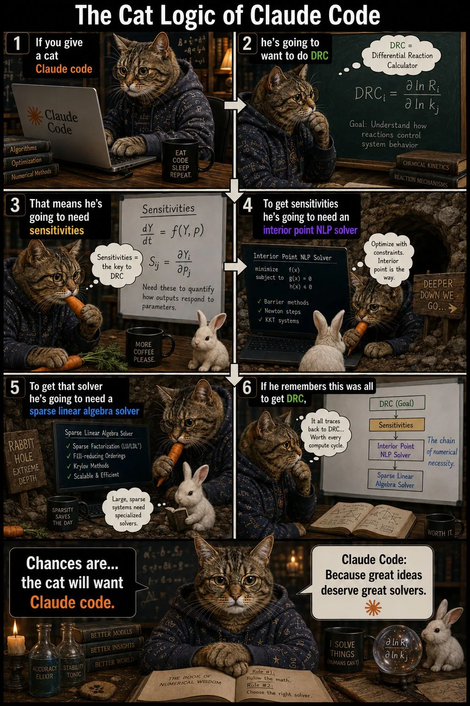

## How a chemical engineer ends up writing solvers

1. I want **sensitivities** of a steady-state model (e.g., degree of rate control)
2. Sensitivities at an optimum come from the **KKT system**
3. That needs a robust **interior point NLP solver**
4. That needs a **sparse symmetric indefinite** factorization with inertia
5. ... so in February I challenged myself: **build Ipopt in Rust, with a new linear solver**

<div class="callout">I expected it to fail and show the limits of agentic coding. It kept working.</div>

<!--
GRC Catalysis, Feb 2026: I said as a community we were not thinking big enough. I did not
know Rust or interior point methods well. Many people did not think it would work.
The first attempt (ripopt) had to be abandoned; the second is feral + pounce.
-->

<!-- scimax-hidden

## Interior point methods in one slide (for me, not for you)

Log barrier, $\mu \to 0$:
$\displaystyle \min_x \; f(x) - \mu \sum_i \ln s_i \quad \text{s.t.} \quad c(x) = 0$

Each Newton step solves the KKT system

$$
\begin{bmatrix} W + \Sigma + \delta_w I & J^\top \\ J & -\delta_c I \end{bmatrix}
\begin{bmatrix} \Delta x \\ \Delta \lambda \end{bmatrix}
= - \begin{bmatrix} \nabla_x \mathcal{L} \\ c(x) \end{bmatrix}
$$

<div class="cols small">
<div>

- Sparse, symmetric **indefinite**, ill-conditioned as $\mu \to 0$
- Needs $LDL^\top$ with pivoting and the **inertia** $(n, m, 0)$ to choose $\delta_w$
- Most of the time, and most of the difficulty, is in this solve

</div>
<div>

- **Bonus:** at the solution, the factored KKT matrix gives $\partial x^*/\partial p$ with one back-solve per parameter (sIPOPT)
- That is what makes the **solver differentiable**

</div>
</div>

scimax-hidden -->

---

## feral → pounce: a pure-Rust interior point family

<div class="cols">
<div class="side">

<div class="cols" style="grid-template-columns: 1fr 1fr; gap: 10px;">
<div class="center">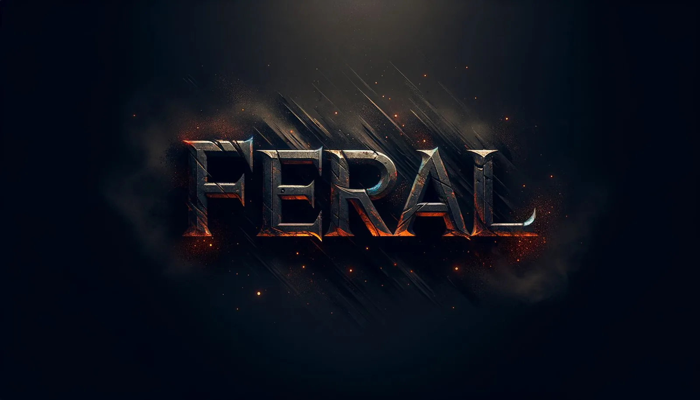<div class="tiny">feral: sparse LDLᵀ, certified inertia</div></div>
<div class="center"><div class="tiny">pounce: NLP / QP / conic</div></div>
</div>

- NLP core began as a **faithful port of Ipopt**: same filter line search, logs, options
- Grew into a family: active-set SQP, LP/QP, SOCP, exp/power cones, small SDP, **SOS** for polynomials
- **sIPOPT-style sensitivity** and reduced Hessian, end to end
- `pip install pounce-solver`, Pyomo plugin, C ABI, **WebAssembly** (solve in the browser)
- Default build is pure Rust: no Fortran, no HSL; MA57 optional

</div>
<div class="center">

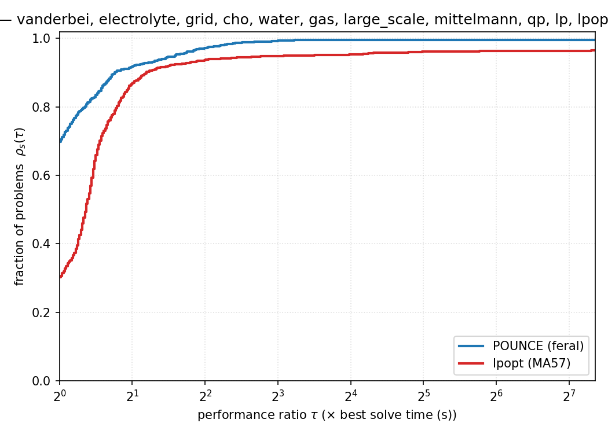

<div class="tiny">Wall-time performance profile on pounce's benchmark harness (CUTEst-style sets, Mittelmann, CHO, gas, water, electrolyte, ...)</div>

</div>
</div>

<!--
Be careful with this audience: the profile is on our own harness of ~1,200 problems, against
Ipopt with MA57. It is evidence the port is solid, not a claim of beating mature commercial
solvers. Feral's job is the KKT solve plus a trustworthy inertia count.
Try it: jkitchin.github.io/pounce/demo (drop an .nl file, solved client-side).
-->

---

## By the numbers, and how it was built

<div class="cols">
<div class="side">

| Repo | Created | Commits | Contributors |
|---|---|---|---|
| **discopt** | Feb 2026 | 4,661 | 3 |
| **pounce** | May 2026 | 3,439 | 6 |
| **difflow** | Dec 2025 | 1,341 | 2 |
| **feral** | Apr 2026 | 1,199 | 2 |
| **jax-go** | Oct 2026 | 342 | 2 |

<div class="tiny">From GitHub, Oct 28 2026. pounce: ~19 MB of Rust source.</div>

</div>
<div class="side">

**The workflow that worked**

- Literature first: curated LLM wikis (**crucible**) on the optimization literature
- **Benchmark-driven**: ~1,200 NLPs, ~180k KKT matrices; the benchmarks are the truth
- Phases with **testable goals**; CI on every push
- A notebook of results **and failed attempts**
- **Adversary agents** to break the code
- Claude Code (Opus 4.5 → 4.8), Max plan, $100-200/month

<div class="callout">This is v2. ripopt (Feb) became too hard to improve; lessons from it shaped feral + pounce.</div>

</div>
</div>

---

## Differentiable solvers: sensitivities from the implicit function theorem

<div class="cols-3-2">
<div class="side">

Steady state $F(\theta; g) = 0$, with $g_i = \ln k_i$:

$$
\frac{d\theta}{dg_i} = -\left( \frac{\partial F}{\partial \theta} \right)^{-1} \frac{\partial F}{\partial g_i}
$$

- $\partial F / \partial \theta$ is the Jacobian **pounce already factored**
- Other partials: AD of the same rate law, no new model
- No finite differences, no re-solve per parameter
- Example: **degree of rate control** for a 17-step propylene oxidation mechanism, in seconds in Python (previously a differentiable stiff integrator in Julia)

</div>
<div class="center">

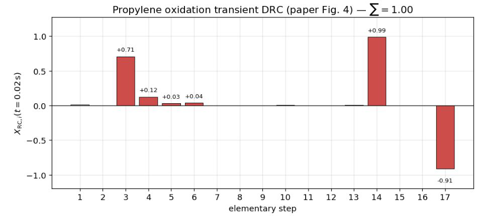

</div>
</div>

<div class="ref">Y. Yang, S. K. Achar, J. R. Kitchin, AIChE J. 68, e17653 (2022), doi:10.1002/aic.17653</div>

<!--
X_RC,i = d ln r / d ln k_i at fixed K_i (Campbell). PO desorption limited (step 14, +0.99),
O2 poisoned (step 17, -0.91). The point for this audience: the solver is a differentiable
layer, so a model built once serves estimation, sensitivity and design.
-->

---

## Equations: discopt, an algebraic modeling language and MINLP solver

<div class="cols-3-2">
<div class="side">

- Python modeling API, **Rust core**; AD tape shared with pounce
- **Spatial branch and bound** over convex relaxations (McCormick, RLT, univariate envelopes), in-house simplex for node LPs; HiGHS for pure MILP
- Decomposition (OA, ECP, Benders, GBD), GDP, MPEC, bilevel, stochastic, robust
- **Embed ML**: NNs, trees, piecewise linear; differentiable MILP/MIQP
- Reads/writes `.nl`, `.gms`, QPLIB; Pyomo and GAMS solver links
- Applications as plugins: **discopt-mkm** (microkinetics), **discopt-calphad** (alloys), **discopt-doe**

<div class="callout">Motivation: model build time can rival solve time for big Pyomo models</div>

</div>
<div class="center">

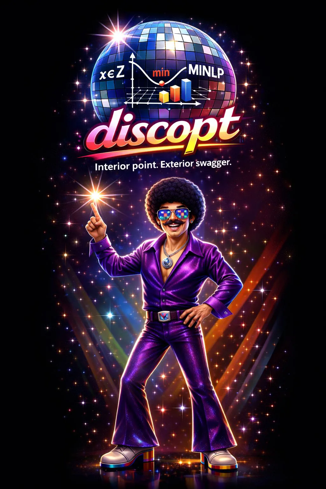

<div class="tiny">github.com/jkitchin/discopt · pip install discopt</div>

</div>
</div>

<!--
This is the part of the landscape where this audience (MINOTAUR, filterSQP) knows far more
than I do. I would value your critique. discopt is broad because agents make breadth cheap;
depth and robustness still come from benchmarks (MINLPLib, QPLIB, CUTEst).
David Bernal contributed major global optimization pieces.
-->

---

## jax-go: certified global optimization of plain JAX functions

<div class="cols">
<div class="side">

Bridges **programs** and **equations**: no algebraic model, just a JAX function and a box

```python
from jaxglobal import minimize

def f(x):  # Eggholder
    a, b = x[0], x[1] + 47
    return (-b * jnp.sin(jnp.sqrt(jnp.abs(a / 2 + b)))
            - a * jnp.sin(jnp.sqrt(jnp.abs(a - b))))

r = minimize(f, [-512, -512], [512, 512])
# fun=-959.64066, lower_bound=-959.64071, gap=4.8e-05
```

</div>
<div class="side">

- Relaxations built by walking the **jaxpr**
- Returns a feasible point **and** a proven lower bound
- **0 wrong answers** on our MINLPLib sets, checked against reference bounds
- Honest status: a research solver, **not yet competitive** with mature global solvers

<div class="callout">Before a fix, it certified a <b>wrong optimum</b> on an application model (invalid subgradients at near-ties). Agents write bugs too; benchmarks found it.</div>

</div>
</div>

---

<!-- _class: lead -->
<!-- _paginate: false -->

# 3. Surrogates that know their uncertainty

### Derivatives so tasks can work through them, σ so they know when to stop

---

<!-- _paginate: false -->
<!-- _footer: '' -->

<style scoped>
section { padding: 6px 20px; }
.ifr { width: 818px; height: 689px; margin: 0 auto; overflow: hidden; position: relative; background: url(figures/zoo-static.webp) 0 0 / 818px auto no-repeat; }
.ifr iframe { width: 1240px; height: 1044px; border: 0; transform: scale(0.66); transform-origin: 0 0; position: absolute; left: 0; top: 0; }
.cap { position: absolute; right: 24px; bottom: 14px; font-size: 12px; color: #5a6b7d; width: 200px; text-align: right; }
.capl { position: absolute; left: 24px; bottom: 14px; font-size: 12px; color: #5a6b7d; width: 200px; }
</style>

<div class="ifr"><iframe src="zoo/zoo.html" title="A zoo of differentiable surrogates"></iframe></div>

<div class="capl">A zoo of differentiable surrogates · 5 packages, ~26 models</div>
<div class="cap">Nearly all sklearn-style: <code>fit</code>, then <code>predict(X, return_std=True)</code></div>

<!--
Hover a model for what it is and how it gets its uncertainty. Four regions: symbolic
grove (jaxsr, iBART, SISSO), decision forest (linear/hyperplane trees, soft trees),
neural meadow (ICNN, monotonic, periodic, KAN, LLPR, DPOSE), and distributions (flows).
Written version: kitchingroup.cheme.cmu.edu/posts/differentiable-surrogate-zoo
-->

---

## Choose the surrogate for what you will do with it

<div class="cols-3-2">
<div class="small">

| If you need… | Reach for |
|---|---|
| An equation you can read and publish | **jaxsr**, iBART, SISSO |
| Exact embedding in a MILP | linear / hyperplane **trees** (jax-ldt) |
| Local optimum = global optimum | input-convex NN (**ICNN**) |
| Monotonic or periodic by construction | monotonic / periodic NN |
| σ for a network you already trust | **LLPR** (last layer, no retraining) |
| Noise that varies with x | soft trees, DPOSE, NN + GMM |
| The whole p(y \| x), inverse design | normalizing flows, soft trees |
| Very little data | regress / nlinfit, response surfaces |

</div>
<div class="side">

**Rules of thumb**

- Structure you can **guarantee** beats structure you hope the data teach
- If it goes into an optimizer, **pick it for the optimizer**
- Interpretability and flexibility trade off
- **Check the uncertainty, not just the fit**: methods fail differently

<div class="callout">Piecewise-linear surrogates embed exactly in a MILP, so the solver can certify a global optimum <i>of the surrogate</i></div>

</div>
</div>

<div class="ref">E. M. Sunshine et al., Comput. Chem. Eng. 202, 109204 (2025), doi:10.1016/j.compchemeng.2025.109204</div>

<!-- scimax-hidden

## Uncertainty drives the next experiment

<div class="cols">
<div class="side">

$$
q(P) = \frac{q_{\max} K P}{1 + K P}
$$

- Low-pressure data only determine the lumped $q_{\max} K$
- Every curve in the 95% region fits the data equally well
- The **Fisher information** from the solver says where to measure next

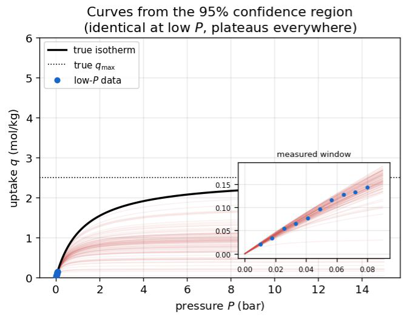

</div>
<div class="center">

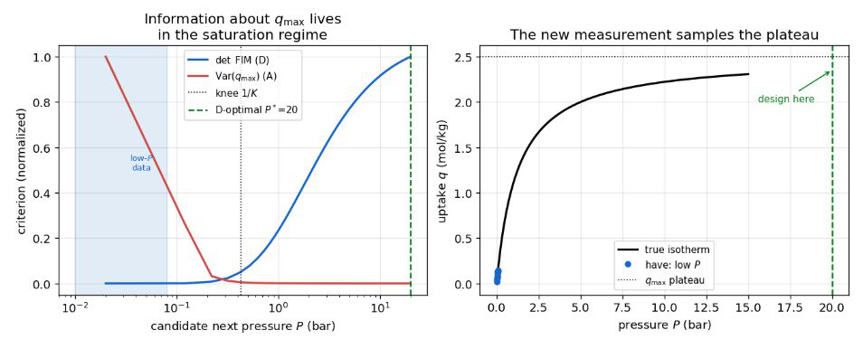

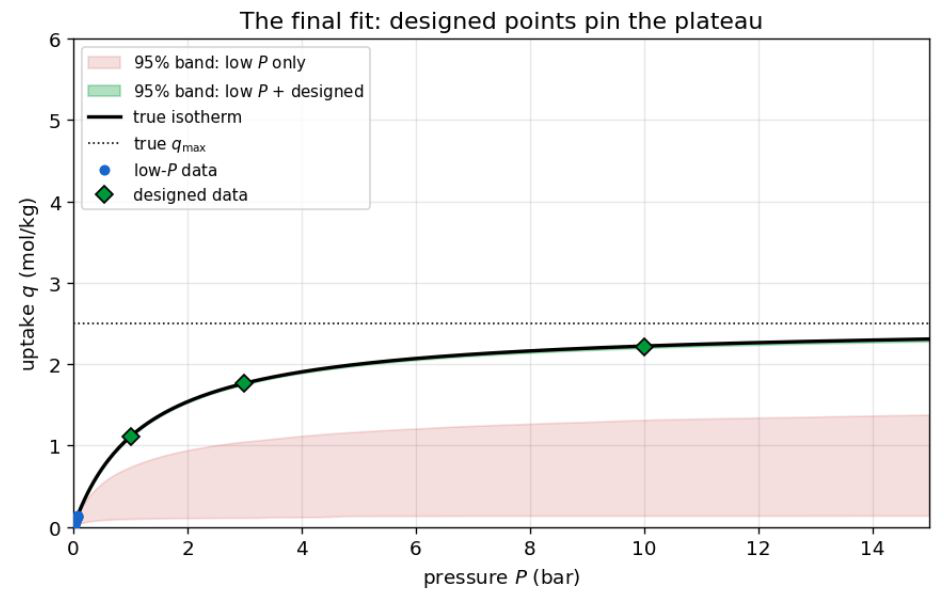

**Before: very uncertain. After: very confident.**

</div>
</div>

<!--
Same machinery as the DRC slide: sensitivities of a solved model. This is the bridge to
the lab: design of experiments is an optimization problem over a differentiable model.
-\->

scimax-hidden -->

---

<!-- _class: lead -->
<!-- _paginate: false -->

# 4. Closing the loop

### Agents, models and robots in the lab

---

## discopt-doe: design of experiments as an agent skill

<div class="cols-2-3">
<div class="center">

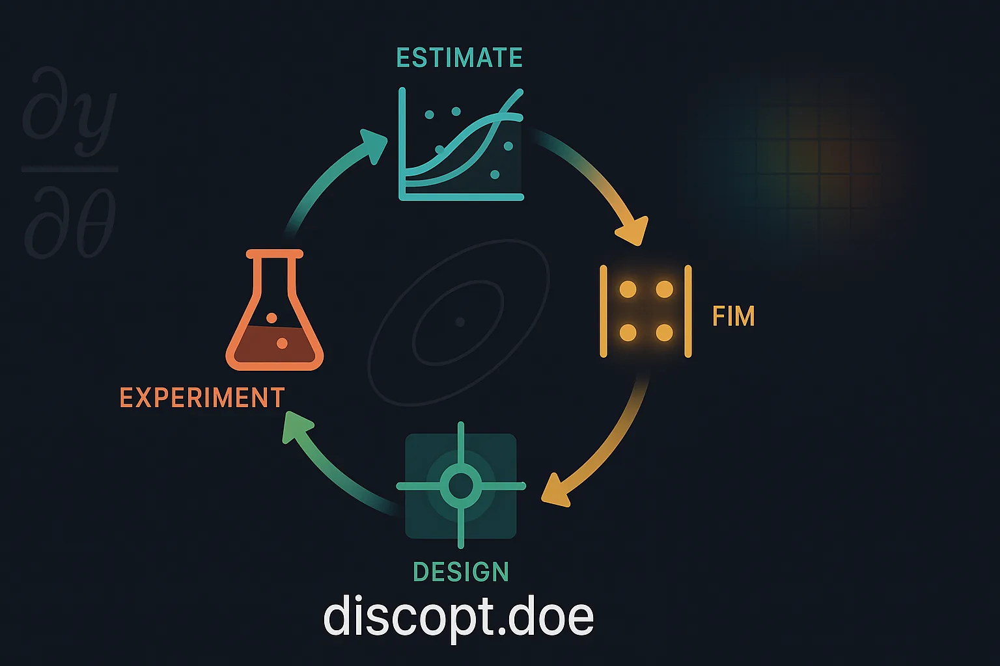

<div class="tiny">github.com/jkitchin/discopt-doe · pip install discopt-doe</div>

</div>
<div class="side">

Three questions, one package:

- **What is the best condition?** Active learning: surrogate + EI/UCB, next batch
- **Does this factor matter?** Factorial, mixture, Latin square designs, ANOVA
- **How well can I estimate parameters?** D/A/E-optimal design from the Fisher information (JAX autodiff), identifiability checks

```bash
discopt doe new response-surface-2d -o c.xlsx --input T:300:500 --n 8
discopt doe fit c.xlsx        # after the lab fills in results
discopt doe extend c.xlsx --n 4
```

<div class="callout">The <code>/doe</code> skill lets the agent run the campaign; the <b>spreadsheet</b> is the hand-off to the lab</div>

</div>
</div>

<!--
This is the experiment-planning engine in the MFI loop. The agent reads the workbook,
fits, proposes the next runs, and the human approves. Browser app (Pyodide, nothing
leaves your machine): jkitchin.github.io/discopt-doe/app/ -- good for teaching too.
-->

---

<!-- _class: lead -->
<!-- _paginate: false -->

# 5. Lessons from working with Claude

---

## What worked

<div class="cols">
<div class="side">

**Engineering practice, applied to agents**

- **Tests and benchmarks are the specification.** The agent iterates against them
- Small phases with **testable goals**, then commit
- **Write down failures**, so the next session does not repeat them
- **Adversary agents**: one writes, another tries to break it
- Give the agent **literature**, not just prompts (crucible)
- Port first, then extend: a faithful Ipopt port gave a reference to diff against

</div>
<div class="side">

**What surprised me**

- Unfamiliar languages (Rust, TypeScript) stopped being a barrier
- Breadth is cheap; **depth and robustness are still expensive**
- Solvers designed *for* agents: JSON solve reports, an **LLM-native debugger**, skills shipped in the repo
- Agents are good at the tedious parts of numerical software: option plumbing, readers, test harnesses

<div class="callout">I am the loop: steering, judging and saying "no" is the job</div>

</div>
</div>

---

## Hazards? Of course

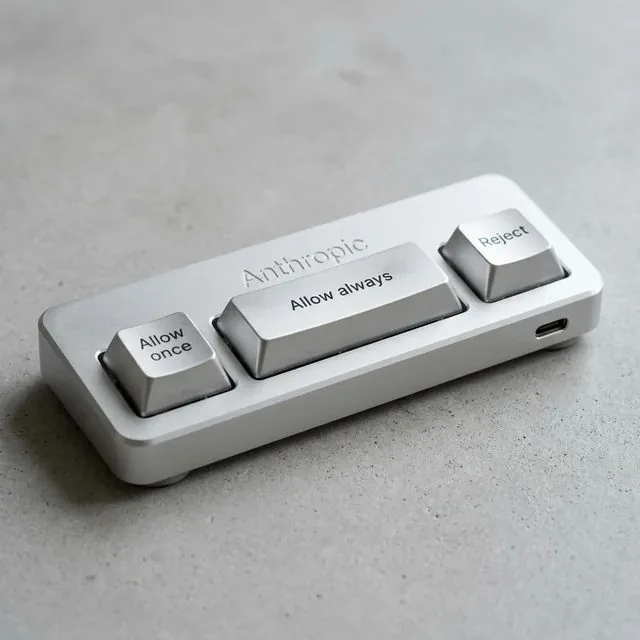

- **Fooling yourself**
  - Easy to generate faster than you can read or verify
  - Code is only as good as the trustworthy benchmarks that test it
  - Confident wrong answers, e.g. a certified-but-wrong global optimum
- **Maintenance and debt**
  - Can these codes be maintained without LLMs? Probably, but *much* slower
- **Attribution**
  - Agents do not know where ideas came from, and can invent references
- **Licensing and provenance**: pounce is EPL-2.0, like Ipopt
- **Cost and access**: $100-200/month; outages; models change under you

---

## We are not thinking big enough, and sustainability is open

<div class="cols">
<div class="side">

- A 10-100x acceleration in **generation** needs a 10-100x larger **user and contributor base**
- Pyomo and IDAES took two decades of federal investment; how do we sustain this?
- Rust is getting native AD; a move from Python/Julia to Rust could take **a year**, not a decade
- There is not one tool to rule optimization: we need a **landscape of pathways**

**Thanks to contributors:** Devin Griffith (sensitivity in pounce), Germán Heim (pounce in oximo), Milan Rother (RSLAB, pounce in the browser), Victor Alves (first pounce user), David Bernal (global optimization in discopt)

</div>
<div class="center">

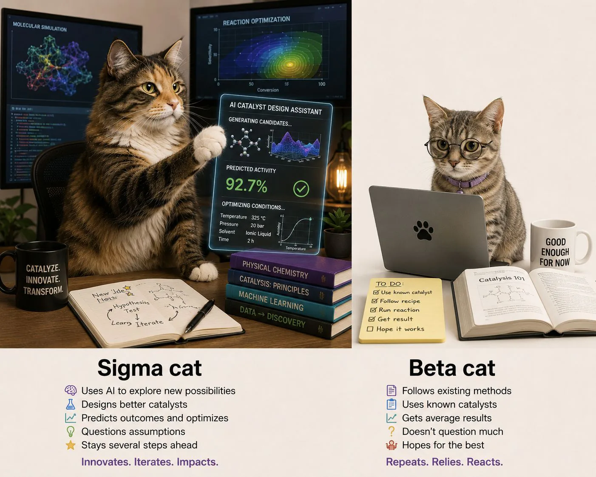

</div>
</div>

---

## Concluding thoughts

<div class="cols-3-2">
<div class="side">

- Agents let a domain scientist build **real numerical software** in months
- They need **knowledge** (skills), **memory** (crucible) and a **human interface** (scimax)
- The payoff is a **differentiable stack**: programs, solvers, and surrogates with UQ that reuse one model for many tasks
- Correctness still comes from **benchmarks, mathematics and experiments**
- I would love your critique, your benchmarks, and your contributions

<div class="small" style="margin-top:14px">

[github.com/jkitchin](https://github.com/jkitchin) · [kitchingroup.cheme.cmu.edu](https://kitchingroup.cheme.cmu.edu) · [youtube.com/@JohnKitchin](https://www.youtube.com/@JohnKitchin)
`pip install pounce-solver discopt discopt-doe jaxsr crucible-llm`

</div>

</div>
<div class="center">

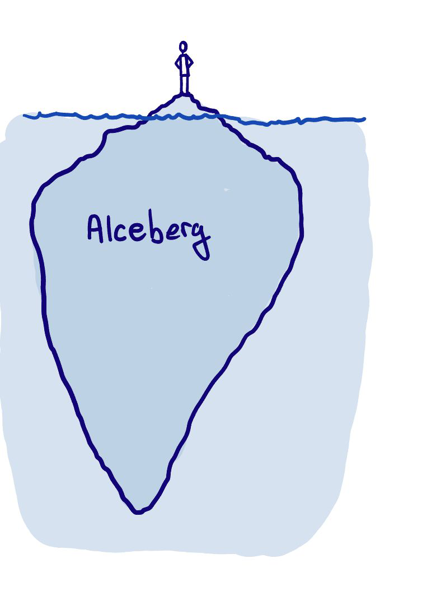

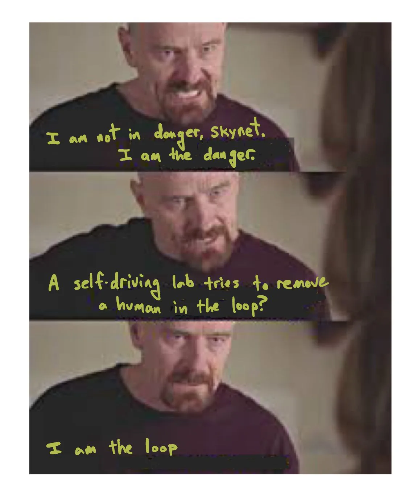

</div>
</div>
